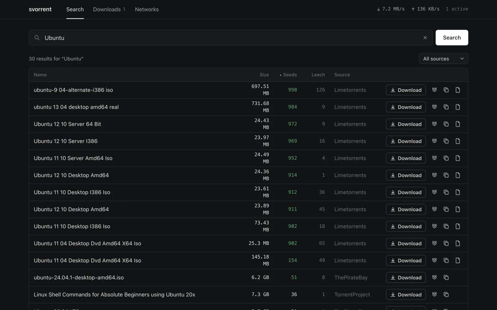
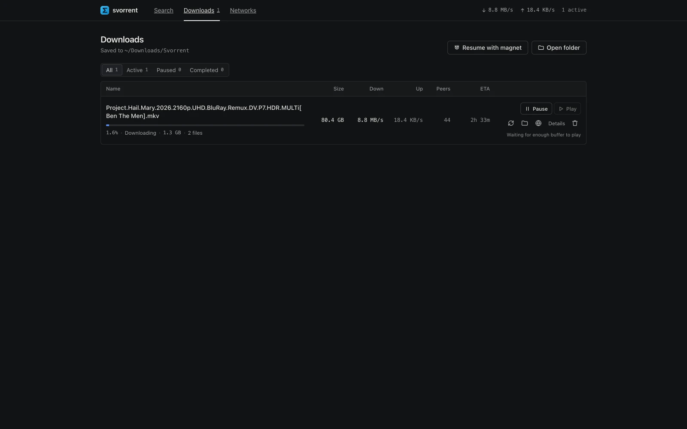
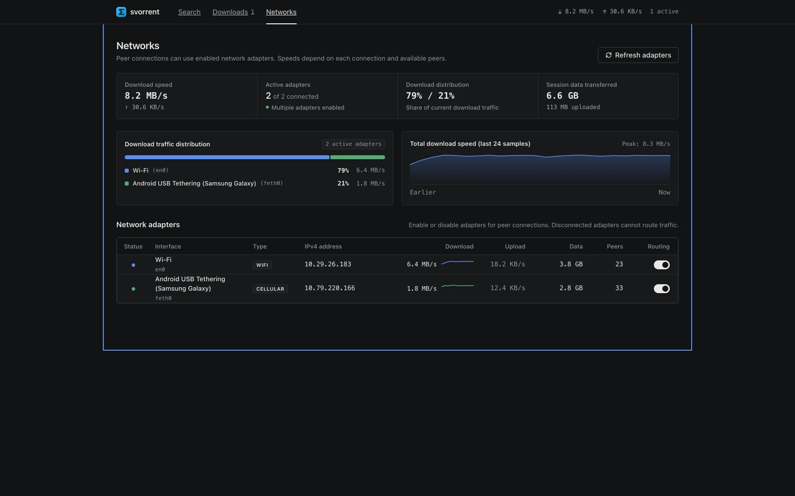

<p align="center">
  
</p>

<h1 align="center">Svorrent</h1>

<p align="center">
  <b>High-performance, lightweight torrent and P2P streaming client with multi-network hardware bonding, sub-second search, sequential playback, and real-time swarm telemetry.</b>
</p>

<p align="center">
  <a href="https://github.com/sovopr/svorrent/releases/latest"></a>
  <a href="https://github.com/sovopr/svorrent/releases"></a>
  <a href="LICENSE"></a>
</p>

---

## Downloads (v1.0.0)

Svorrent uses a lightweight web-native client architecture. Instead of bundling a heavy 150MB+ Chromium runtime, native desktop launchers start a silent background daemon and open the interface directly in your default web browser.

| Platform | Package | Size | Description |
| :--- | :--- | :--- | :--- |
| **Windows (x64)** | [**`Svorrent-Setup.exe`**](https://github.com/sovopr/svorrent/releases/download/v1.0.0/Svorrent-Setup.exe) | **9.8 MB** | **Recommended.** Modern Windows installer with Desktop & Start Menu shortcuts. |
| **Windows (x64)** | [**`Svorrent-Windows-x64-Portable.zip`**](https://github.com/sovopr/svorrent/releases/download/v1.0.0/Svorrent-Windows-x64-Portable.zip) | **20.0 MB** | Standalone portable archive. Unzip anywhere and launch `Svorrent.exe`. |
| **macOS (Universal)** | [**`Svorrent.dmg`**](https://github.com/sovopr/svorrent/releases/download/v1.0.0/Svorrent.dmg) | **19.6 MB** | Native Apple disk image. Drag `Svorrent.app` into `/Applications`. |

---

## Features & Interface Workflow

### 1. Multi-Tracker Search Aggregation
The search interface aggregates results concurrently across public indexers (including The Pirate Bay, LimeTorrents, and TorrentProject) with bounded 2.5s provider timeouts.
- Queries are deduplicated, normalized, and sortable by seeds, leechers, file size, or indexer source.
- Magnets launch directly into the download pipeline with a single click.



### 2. Downloads Manager & Streaming Controls
The downloads dashboard manages active transfers, sequential chunk scheduling, and instant media playback.



#### 2.1 Sequential Piece Scheduling & Crash Recovery
- Forces sequential piece acquisition (from piece 0 to piece N) to enable immediate streaming instead of random piece distribution.
- Prioritizes container headers and initial chapters (first 25 MB and initial 20 pieces) with critical queue weighting.
- Atomic session snapshots store torrent metadata and verified-piece bitfields in `~/.svorrent/session.json` to accelerate resumption. Saves are batched; a crash can lose recent progress, and missing or changed files may require verification or re-downloading.
- Scans `~/Downloads/Svorrent` to detect orphaned files and halfway downloads, matching them to magnet hashes for one-click resumption.

#### 2.2 In-App Storage & File Deletion
- Custom in-app confirmation modal prevents accidental deletions.
- Option to remove torrent metadata only or permanently delete all associated files and downloaded folders from disk (`~/Downloads/Svorrent/`).
- Invalidation hooks immediately clear file scanner caches and purge persisted session checkpoints.

#### 2.3 Playback Readiness & VLC Integration
Instead of waiting for an entire file to finish downloading, Svorrent continuously evaluates the physical streaming condition:
$$\text{Download ETA} \times 1.20 \le \text{Video Runtime}$$

- Media container runtimes are extracted in the background via `ffprobe` (or estimated from container size if unprobed).
- While downloading, the Play button remains disabled and greyed out until the readiness estimate passes, with its hover tooltip displaying estimated buffering requirements.
- Once the 20% safety threshold is satisfied, the Play button activates in cyan. Clicking it executes `open -a VLC <filepath>` (macOS) or launches VLC / system default media player (Windows), opening the growing file directly.

#### 2.4 Swarm Telemetry Matrix & Peer Inspector
Every download row includes an isolated Swarm button opening a per-torrent inspector with a dual-view switcher:


- **Piece Bitfield & Sequential Streaming Frontier**: Renders verified chunk blocks on disk alongside real-time download blocks and the sequential playback frontier cursor.
- **Swarm Piece Availability Heatmap**: Visualizes piece availability rarity across all connected peers from rare (<25%) to abundant (100%).
- **Multi-Interface Breakdown & Protocol Badging**: Inspects remote peer connections broken down by local physical adapter (Wi-Fi, USB Tether, Ethernet) with clear TCP vs. uTP (Micro Transport Protocol) and WebRTC badges.
- **Global GeoIP Topology (Secondary View)**: Toggle over to the interactive vector SVG world map plotting remote peer coordinates and country contributions via offline `geoip-lite`.

### 3. Multi-Network Pooling & Bandwidth Bonding
Svorrent can distribute outgoing peer connections across multiple local interfaces. Additional throughput depends on routing, independent uplinks, peer availability, and network conditions.



- **Combined Speed Pooling**: Wi-Fi, cellular tethering, Ethernet, and secondary USB adapters can contribute separate peer connections. Their nominal speeds describe potential capacity; actual torrent speed is not guaranteed to equal their sum.
- **Kernel-Level Socket Striping**: Because torrent swarms rely on dozens of concurrent peer wires, Svorrent binds discrete outgoing TCP sockets to each physical network adapter's local IP address (`localAddress`). Peer traffic is distributed across all enabled interfaces, pooling bandwidth without requiring paid bonding VPN subscriptions or multi-WAN hardware routers.
- **Android USB Tethering (macOS)**: After installing the privileged `svorrent-tetherd` service and enabling USB tethering on a compatible Android phone, the daemon detects an exposed RNDIS device, creates a virtual interface, and requests DHCP configuration. Installation requires administrator authorization and the daemon runs as root.
- **Per-Adapter Controls & Live Telemetry**: Any interface in the pool can be enabled or disabled on the fly from the Networks dashboard, which displays real-time bandwidth balancing percentages, per-adapter sparklines, and session data counters.

---

## Architecture

```
svorrent/
├── backend/
│   ├── server.js                # Express REST API and WebTorrent orchestration
│   ├── bin/                     # Native compiled daemons and shared libraries
│   │   ├── svorrent-tetherd     # Native background tethering daemon
│   │   ├── libtetherkit*.dylib  # TetherKit C ABI library and symlinks
│   │   └── libusb-1.0.0.dylib  # USB dependency
│   ├── tether/                  # C++ tether daemon source (RNDIS / libusb)
│   ├── lib/
│   │   ├── networks.js          # Kernel-level multi-interface socket routing
│   │   ├── playability.js       # Buffer-free streaming math and ffprobe extraction
│   │   ├── session.js           # Atomic bitfield checkpointing and recovery
│   │   ├── scanner.js           # Directory scanner for orphaned and halfway files
│   │   ├── trackers.js          # Dynamic public tracker fallback lists
│   │   ├── archive.js           # Torrent metadata storage
│   │   └── torrents.js          # Shared lifecycle synchronization and magnet parsing
│   └── scripts/
│       ├── install-tetherd.sh   # Launchd service installer for macOS
│       └── uninstall-tetherd.sh # Service uninstaller
├── frontend/
│   ├── src/
│   │   ├── App.jsx              # Navigation and global polling loop
│   │   ├── SearchPage.jsx       # Multi-tracker search query interface
│   │   ├── DownloadsManager.jsx # Download queue, action controls, and VLC triggers
│   │   ├── SwarmModal.jsx       # Swarm inspector, country charts, and peer table
│   │   ├── SwarmWorldMap.jsx    # SVG vector map with centroid peer plotting
│   │   ├── NetworksPage.jsx     # Network adapter status and traffic telemetry
│   │   └── TorrentDetails.jsx   # Inspector for trackers, files, and bitfield pieces
│   └── package.json
└── scripts/
    ├── build-dmg.sh             # macOS .app bundle and compressed DMG builder
    ├── build-windows.sh         # Windows Win32 launcher, NSIS installer, and portable ZIP builder
    ├── launcher.c               # Native Win32 background daemon launcher (C/MinGW)
    ├── launcher.rc              # Windows icon resource & manifest definition
    └── installer.nsi            # Nullsoft NSIS installer configuration (LZMA solid compression)
```

---

## Getting Started from Source

### Prerequisites
- Node.js (v18 or higher, recommended v22+)
- Optional: VLC Media Player (`/Applications/VLC.app` or `vlc` in PATH)
- Optional: `ffprobe` for container runtime extraction

### 1. Backend Setup

```bash
cd backend
npm ci
npm start
```

The API service runs on `http://localhost:3001`. Downloads are written to `~/Downloads/Svorrent/`.

### 2. Frontend Setup

```bash
cd frontend
npm ci
npm run dev
```

The interface runs on `http://localhost:5173`.

### 3. Packaging Releases

To build production desktop distributions (< 20 MB):

```bash
# Build macOS .dmg (outputs to dist-app/Svorrent.dmg)
cd backend
npm run build:dmg

# Build Windows installer & portable zip (outputs to dist-win/)
cd backend
npm run build:win
```

---

## System Architecture

The following diagram details the interconnectivity between the client interface, backend coordination subsystems, kernel-level network binding, and external peer connections:


---

## Technical Specifications

| Component | Implementation |
| :--- | :--- |
| Core Protocol & Swarm | WebTorrent, P2P Wire Protocol, DHT |
| Desktop Architecture | Native Win32 / macOS browser-client launchers (< 20 MB footprint, no Electron overhead) |
| Search Engine | Multi-provider aggregation with bounded timeouts & DoH anti-censorship shield |
| Network Routing & Bonding | Multi-interface OS socket binding via local IP assignment and dynamic routing table failover |
| Media Analysis | ffprobe metadata extraction + analytic ETA-vs-runtime buffer formula |
| Swarm Telemetry | Piece bitfield availability heatmap, interface breakdown, and native SVG map |
| GeoIP Resolution | Offline MaxMind GeoLite database via geoip-lite |
| UI Framework | React 19, Vite, Vanilla CSS |

---

## License

MIT
