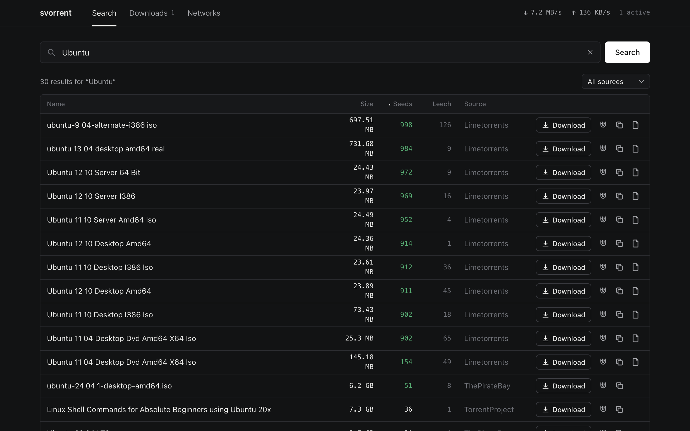
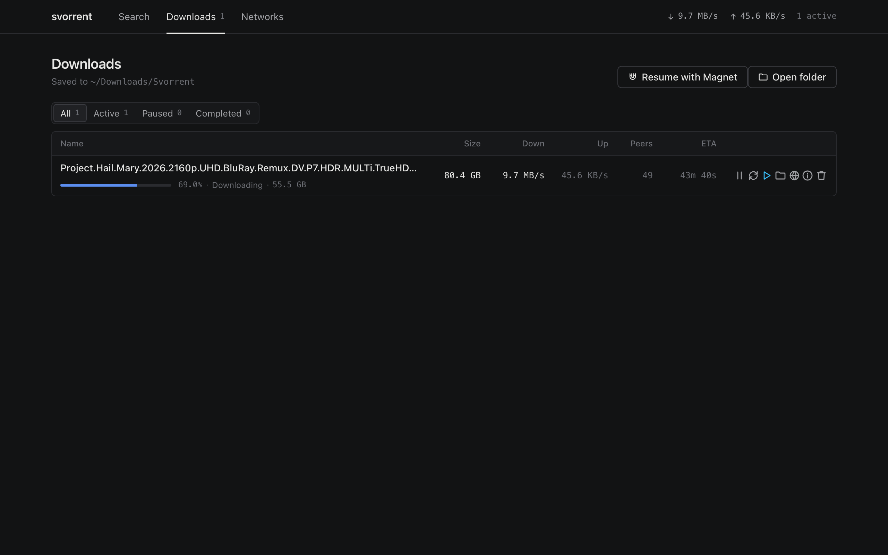
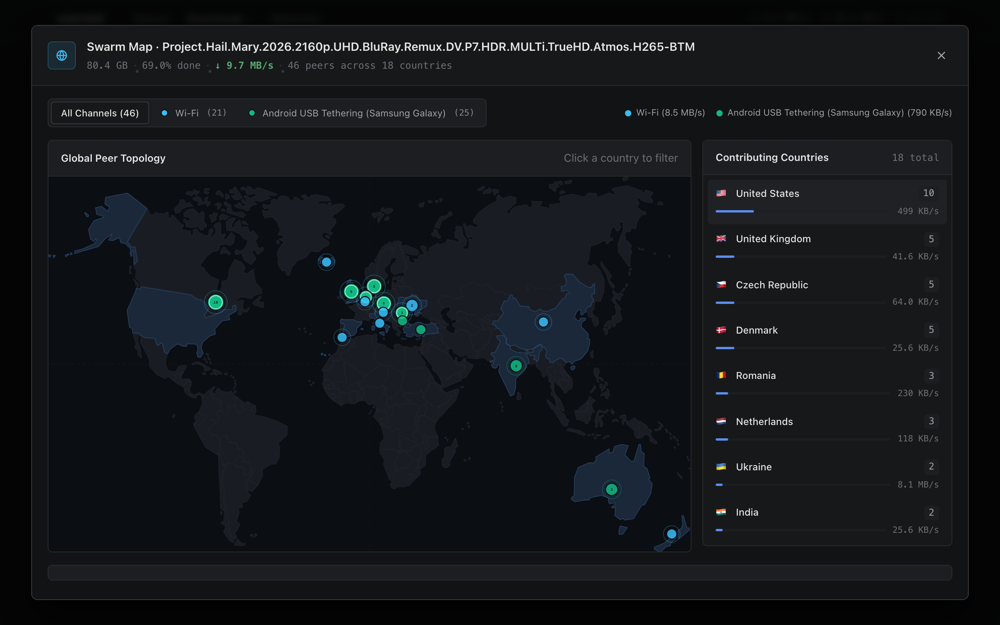
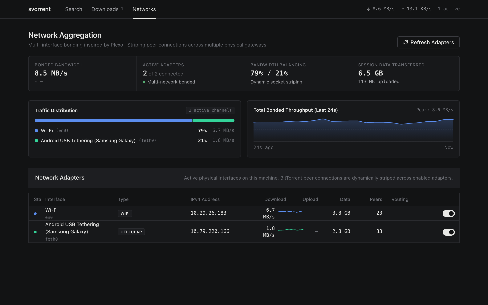

# Svorrent

Svorrent is a local BitTorrent client and indexing engine built with Node.js, WebTorrent, and React. It implements multi-tracker search aggregation, sequential piece streaming with buffer-free playback, per-torrent swarm visualization, and multi-network socket bonding across physical interfaces.

---

## Features & Interface Workflow

### 1. Multi-Tracker Search Aggregation
The search interface aggregates results concurrently across public indexers (including The Pirate Bay, LimeTorrents, and TorrentProject).
- Queries are deduplicated, normalized, and sortable by seeds, leechers, file size, or indexer source.
- Magnets launch directly into the download pipeline with a single click.



### 2. Downloads Manager & Streaming Controls
The downloads dashboard manages active transfers, sequential chunk scheduling, and instant media playback.



#### 2.1 Sequential Piece Scheduling & Crash Recovery
- Forces sequential piece acquisition (from piece 0 to piece N) to enable immediate streaming instead of random piece distribution.
- Prioritizes container headers and initial chapters (first 25 MB and initial 20 pieces) with critical queue weighting.
- Atomic bitfield state checkpoints write to `session.json` on every verified block, ensuring that daemon restarts or power interruptions resume immediately from existing disk blocks without re-checking or re-downloading.
- Scans `~/Downloads/Svorrent` to detect orphaned files and halfway downloads, matching them to magnet hashes for one-click resumption.

#### 2.2 Buffer-Free Streaming & VLC Integration
Instead of waiting for an entire file to finish downloading, Svorrent continuously evaluates the physical streaming condition:
$$\text{Download ETA} \times 1.20 \le \text{Video Runtime}$$

- Media container runtimes are extracted in the background via `ffprobe` (or estimated from container size if unprobed).
- While downloading, the Play button remains disabled and greyed out, with its hover tooltip displaying the exact byte buffer needed and estimated time remaining until continuous playback is guaranteed.
- Once the 20% safety threshold is satisfied, the Play button activates in cyan. Clicking it executes `open -a VLC <filepath>`, opening the growing file directly in VLC (or the system default media player).

#### 2.3 Per-Torrent Swarm Topology & GeoIP Inspector
Every download row includes an isolated Swarm Map button opening a per-torrent inspector.



- Renders an interactive vector SVG world map plotting peer centroids without WebGL overhead.
- Maps remote peer IP addresses to countries and cities using an offline `geoip-lite` database.
- Provides dynamic segmented filters across connected network interfaces (Wi-Fi, USB Tether, Ethernet, Bridges) with color-coded throughput metrics.
- Displays ranked country contributions and a searchable peer wire table with remote client software identification (qBittorrent, Transmission, Deluge, libtorrent).

### 3. Multi-Interface Network Bonding
Svorrent aggregates bandwidth across multiple active network connections by binding outgoing peer sockets at the OS kernel level.



- Outgoing TCP and uTP peer connections are distributed across available network devices (`en0` Wi-Fi, `feth0` Android USB tether, `en1` Ethernet) to maximize aggregate throughput.
- An autonomous background daemon (`scripts/tether-daemon.js`) polls for connected Android devices via `adb`, enables USB tethering mode automatically without passwords, acquires local DHCP addresses, and configures multi-path routing rules.

---

## Architecture

```
svorrent/
├── backend/
│   ├── server.js                # Express REST API and WebTorrent orchestration
│   ├── lib/
│   │   ├── networks.js          # Kernel-level multi-interface socket routing
│   │   ├── playability.js       # Buffer-free streaming math and ffprobe extraction
│   │   ├── session.js           # Atomic bitfield checkpointing and recovery
│   │   ├── scanner.js           # Directory scanner for orphaned and halfway files
│   │   ├── trackers.js          # Dynamic public tracker fallback lists
│   │   └── archive.js           # Torrent metadata storage
│   └── scripts/
│       ├── tether-daemon.js     # Autonomous Android USB tethering agent
│       ├── install-tetherd.sh   # Launchd service installer for macOS
│       └── uninstall-tetherd.sh # Service uninstaller
└── frontend/
    ├── src/
    │   ├── App.jsx              # Navigation and global polling loop
    │   ├── SearchPage.jsx       # Multi-tracker search query interface
    │   ├── DownloadsManager.jsx # Download queue, action controls, and VLC triggers
    │   ├── SwarmModal.jsx       # Swarm inspector, country charts, and peer table
    │   ├── SwarmWorldMap.jsx    # SVG vector map with centroid peer plotting
    │   ├── NetworksPage.jsx     # Network adapter status and traffic telemetry
    │   └── TorrentDetails.jsx   # Inspector for trackers, files, and bitfield pieces
    └── package.json
```

---

## Getting Started

### Prerequisites
- Node.js (v18 or higher)
- Optional: VLC Media Player (`/Applications/VLC.app` or `vlc` in PATH)
- Optional: `ffprobe` for container runtime extraction
- Optional for Android bonding: `adb` (`brew install android-platform-tools`)

### 1. Backend Setup

```bash
cd backend
npm install
npm start
```

The API service runs on `http://localhost:3001`. Downloads are written to `~/Downloads/Svorrent/`.

### 2. Frontend Setup

```bash
cd frontend
npm install
npm run dev
```

The interface runs on `http://localhost:5173`.

### 3. Optional: Android USB Tether Daemon (macOS)
To bond an Android phone's mobile connection alongside Wi-Fi automatically:

```bash
cd backend
npm run setup:tether
```

This installs a system launchd daemon that detects Android devices connected via USB, enables tethering mode, and configures the `feth0` network interface.

---

## Technical Specifications

| Component | Implementation |
| :--- | :--- |
| BitTorrent Protocol | WebTorrent, bittorrent-protocol, bittorrent-dht |
| Network Routing | OS socket binding via local IP assignment |
| Media Analysis | ffprobe metadata extraction + analytic ETA-vs-runtime buffer formula |
| Swarm Map | Native SVG with BBox centroid coordinates (zero WebGL) |
| GeoIP Resolution | Offline MaxMind GeoLite database via geoip-lite |
| UI Framework | React 18, Vite, Vanilla CSS |

---

## License

MIT
