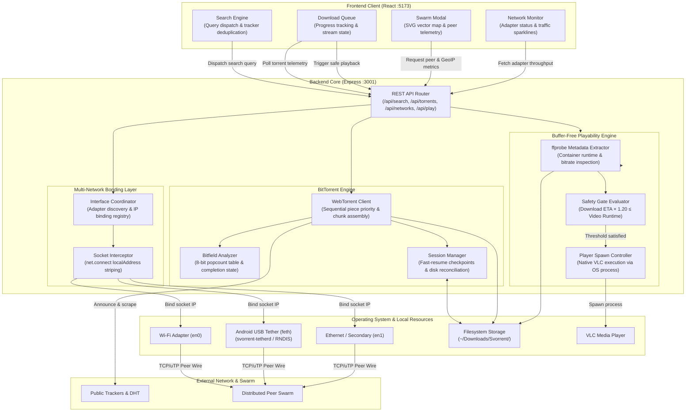

# Svorrent

Svorrent is a local BitTorrent client and indexing engine built with Node.js, WebTorrent, and React. It implements multi-tracker search aggregation, sequential piece streaming with playback-readiness estimates, per-torrent swarm visualization, and multi-network socket binding across physical interfaces.

---

## Features & Interface Workflow

### 1. Multi-Tracker Search Aggregation
The search interface aggregates results concurrently across public indexers (including The Pirate Bay, LimeTorrents, and TorrentProject).
- Queries are deduplicated, normalized, and sortable by seeds, leechers, file size, or indexer source.
- Magnets launch directly into the download pipeline with a single click.


### 2. Downloads Manager & Streaming Controls
The downloads dashboard manages active transfers, sequential chunk scheduling, and instant media playback.


#### 2.1 Sequential Piece Scheduling & Crash Recovery
- Forces sequential piece acquisition (from piece 0 to piece N) to enable immediate streaming instead of random piece distribution.
- Prioritizes container headers and initial chapters (first 25 MB and initial 20 pieces) with critical queue weighting.
- Atomic session snapshots store torrent metadata and verified-piece bitfields in `~/.svorrent/session.json` to accelerate resumption. Saves are batched; a crash can lose recent progress, and missing or changed files may require verification or re-downloading.
- Scans `~/Downloads/Svorrent` to detect orphaned files and halfway downloads, matching them to magnet hashes for one-click resumption.

#### 2.2 Playback Readiness & VLC Integration
Instead of waiting for an entire file to finish downloading, Svorrent continuously evaluates the physical streaming condition:
$$\text{Download ETA} \times 1.20 \le \text{Video Runtime}$$

- Media container runtimes are extracted in the background via `ffprobe` (or estimated from container size if unprobed).
- While downloading, the Play button remains disabled and greyed out until the readiness estimate passes, with its hover tooltip displaying estimated buffering requirements. Changes in peer speed, media bitrate, and file layout can still cause playback to stall.
- Once the 20% safety threshold is satisfied, the Play button activates in cyan. Clicking it executes `open -a VLC <filepath>`, opening the growing file directly in VLC (or the system default media player).

#### 2.3 Swarm Telemetry Matrix & Peer Inspector
Every download row includes an isolated Swarm button opening a per-torrent inspector with a dual-view switcher:


- **Piece Bitfield & Sequential Streaming Frontier**: Renders verified chunk blocks on disk alongside real-time download blocks and the sequential playback frontier cursor.
- **Swarm Piece Availability Heatmap**: Visualizes piece availability rarity across all connected peers from rare (<25%) to abundant (100%).
- **Multi-Interface Breakdown & Protocol Badging**: Inspects remote peer connections broken down by local physical adapter (Wi-Fi, USB Tether, Ethernet) with clear TCP vs. uTP (Micro Transport Protocol) and WebRTC badges.
- **Global GeoIP Topology (Secondary View)**: Toggle over to the interactive vector SVG world map plotting remote peer coordinates and country contributions via offline `geoip-lite`.

### 3. Multi-Network Pooling & Bandwidth Bonding
Svorrent can distribute outgoing peer connections across multiple local interfaces. Additional throughput depends on routing, independent uplinks, peer availability, and network conditions.


- **Combined Speed Pooling**: Wi-Fi, cellular tethering, Ethernet, and secondary USB adapters can contribute separate peer connections. Their nominal speeds describe potential capacity; actual torrent speed is not guaranteed to equal their sum.
- **Kernel-Level Socket Striping**: Because BitTorrent relies on dozens of concurrent peer wires, Svorrent binds discrete outgoing TCP sockets to each physical network adapter's local IP address (`localAddress`). Peer traffic is distributed across all enabled interfaces, pooling bandwidth without requiring paid bonding VPN subscriptions or multi-WAN hardware routers.
- **Android USB Tethering (macOS)**: After installing the privileged `svorrent-tetherd` service and enabling USB tethering on a compatible Android phone, the daemon detects an exposed RNDIS device, creates a virtual interface, and requests DHCP configuration. Installation requires administrator authorization and the daemon runs as root. It does not enable tethering on the phone; Android root access and `adb` are not required by this daemon.
- **Per-Adapter Controls & Live Telemetry**: Any interface in the pool can be enabled or disabled on the fly from the Networks dashboard, which displays real-time bandwidth balancing percentages, per-adapter sparklines, and session data counters.

---

## Architecture

```
svorrent/
├── backend/
│   ├── server.js                # Express REST API and WebTorrent orchestration
│   ├── bin/                     # Native compiled daemons and shared libraries
│   │   ├── svorrent-tetherd     # Native background tethering daemon
│   │   ├── libtetherkit*.dylib  # TetherKit C ABI library and symlinks
│   │   └── libusb-1.0.0.dylib  # USB dependency
│   ├── tether/                  # C++ tether daemon source (RNDIS / libusb)
│   ├── lib/
│   │   ├── networks.js          # Kernel-level multi-interface socket routing
│   │   ├── playability.js       # Buffer-free streaming math and ffprobe extraction
│   │   ├── session.js           # Atomic bitfield checkpointing and recovery
│   │   ├── scanner.js           # Directory scanner for orphaned and halfway files
│   │   ├── trackers.js          # Dynamic public tracker fallback lists
│   │   └── archive.js           # Torrent metadata storage
│   └── scripts/
│       ├── install-tetherd.sh   # Launchd service installer for macOS
│       └── uninstall-tetherd.sh # Service uninstaller
└── frontend/
    ├── src/
    │   ├── App.jsx              # Navigation and global polling loop
    │   ├── SearchPage.jsx       # Multi-tracker search query interface
    │   ├── DownloadsManager.jsx # Download queue, action controls, and VLC triggers
    │   ├── SwarmModal.jsx       # Swarm inspector, country charts, and peer table
    │   ├── SwarmWorldMap.jsx    # SVG vector map with centroid peer plotting
    │   ├── NetworksPage.jsx     # Network adapter status and traffic telemetry
    │   └── TorrentDetails.jsx   # Inspector for trackers, files, and bitfield pieces
    └── package.json
```

---

## Getting Started

### Prerequisites
- Node.js 22.12 or higher for the current backend and frontend lockfiles (WebTorrent requires Node 22+, and Vite requires Node 20.19+ or 22.12+).
- Optional: VLC Media Player (`/Applications/VLC.app` or `vlc` in PATH)
- Optional: `ffprobe` for container runtime extraction
- Optional for Android tethering: a compatible macOS native build and a phone exposing RNDIS USB tethering. See the native release limitations below.

### 1. Backend Setup

```bash
cd backend
npm ci
npm start
```

The API service runs on `http://localhost:3001`. Downloads are written to `~/Downloads/Svorrent/`.

### 2. Frontend Setup

```bash
cd frontend
npm ci
npm run dev
```

The interface runs on `http://localhost:5173`.

### 3. Optional: Android USB Tether Daemon (macOS)
To use an Android phone's mobile connection alongside Wi-Fi, first enable USB tethering on the phone. The installer below invokes `sudo`; it installs a system LaunchDaemon. Review the release limitations below before using the current installer.

```bash
cd backend
npm run setup:tether
```

The service detects RNDIS devices, creates a `feth` interface (its number may vary), and requests DHCP without explicitly replacing the global default route. It monitors disconnects and retries connections. Logs are written to `/var/log/svorrent-tetherd.log`.

The native source can be rebuilt with `npm run build:tether` from `backend/`, using Xcode Command Line Tools and the supplied TetherKit libraries. `backend/bin/svorrent-tetherd --list` lists devices without root; a failed scan exits nonzero. `--once` waits for the first successful session, monitors it until it ends or a termination signal arrives, then exits without reconnecting. Native source edits require rebuilding the daemon before packaging; the checked-in executable is not updated automatically.

The native regression checks use a stub TetherKit implementation and do not access USB, change networking, or need root. From the repository root:

```bash
tether_test_dir="$(mktemp -d)"
clang++ -std=c++17 -Wall -Wextra -Werror -g \
  -fsanitize=address,undefined -fno-omit-frame-pointer \
  backend/tether/tests/daemon_test.cc -o "$tether_test_dir/daemon-test"
"$tether_test_dir/daemon-test"
```

### Release limitations

- The checked-in native daemon and libraries are ARM64-only and declare a macOS 27.0 minimum in their Mach-O build metadata. The generated app's macOS 11.0 declaration does not describe these native components. Rebuild and test every bundled native dependency for each intended architecture and minimum OS before distributing it.
- The checked-in daemon loads TetherKit from an absolute `/opt/homebrew/opt/tetherkit/...` path. Copying the adjacent libraries into an app or `/Library/PrivilegedHelperTools` does not fix that dependency. Packaging must make the load paths relocatable and sign the resulting binaries after modification.
- The DMG builder copies the existing `node_modules` tree and does not bundle Node.js or the tether service installer. A clean release needs a compatible runtime, dependencies installed for the target platform, and a documented tether installation path. The builder also removes city-level GeoIP databases, which limits location detail in the swarm view.
- The current tether installer changes permissions and signatures on all top-level `.dylib` files in `/Library/PrivilegedHelperTools`; the uninstaller removes matching shared libraries and destroys every `feth` interface. These operations need to be restricted to Svorrent-owned resources before release, especially on machines with other tethering software.
- Confirm redistribution provenance and notices for TetherKit, libusb, native Node dependencies, and GeoIP data. The repository's MIT label does not establish the licensing terms of those bundled components.

---

## System Architecture

The following diagram details the interconnectivity between the client interface, backend coordination subsystems, kernel-level network binding, and external peer connections:



---

## Technical Specifications

| Component | Implementation |
| :--- | :--- |
| BitTorrent Protocol | WebTorrent, bittorrent-protocol, bittorrent-dht |
| Search Engine | Plug-and-play public index aggregation with automated Cloudflare/Google DoH anti-censorship shield |
| Network Routing & Bonding | Multi-interface OS socket binding via local IP assignment and dynamic routing table failover |
| Media Analysis | ffprobe metadata extraction + analytic ETA-vs-runtime buffer formula |
| Swarm Telemetry | Piece bitfield availability heatmap, interface breakdown, and native SVG map |
| GeoIP Resolution | Offline MaxMind GeoLite database via geoip-lite |
| UI Framework | React 19, Vite, Vanilla CSS |

---

## License

MIT
