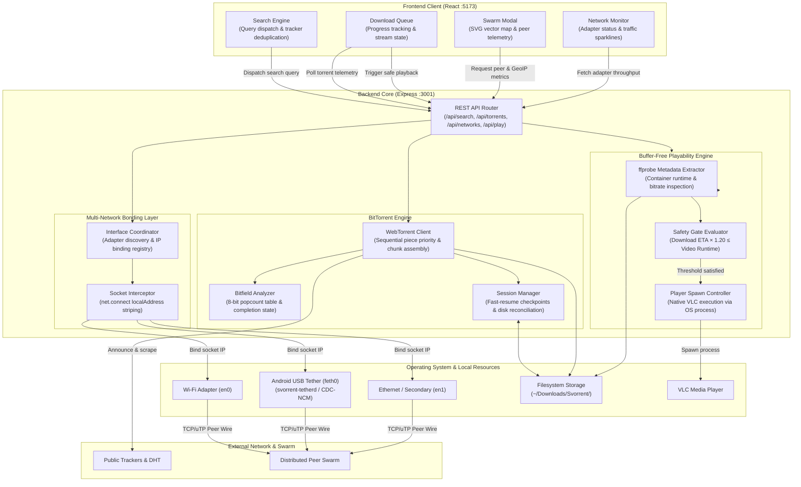

# Svorrent

Svorrent is a local BitTorrent client and indexing engine built with Node.js, WebTorrent, and React. It implements multi-tracker search aggregation, sequential piece streaming with buffer-free playback, per-torrent swarm visualization, and multi-network socket bonding across physical interfaces.

---

## Features & Interface Workflow

### 1. Multi-Tracker Search Aggregation
The search interface aggregates results concurrently across public indexers (including The Pirate Bay, LimeTorrents, and TorrentProject).
- Queries are deduplicated, normalized, and sortable by seeds, leechers, file size, or indexer source.
- Magnets launch directly into the download pipeline with a single click.


### 2. Downloads Manager & Streaming Controls
The downloads dashboard manages active transfers, sequential chunk scheduling, and instant media playback.


#### 2.1 Sequential Piece Scheduling & Crash Recovery
- Forces sequential piece acquisition (from piece 0 to piece N) to enable immediate streaming instead of random piece distribution.
- Prioritizes container headers and initial chapters (first 25 MB and initial 20 pieces) with critical queue weighting.
- Atomic bitfield state checkpoints write to `session.json` on every verified block, ensuring that daemon restarts or power interruptions resume immediately from existing disk blocks without re-checking or re-downloading.
- Scans `~/Downloads/Svorrent` to detect orphaned files and halfway downloads, matching them to magnet hashes for one-click resumption.

#### 2.2 Buffer-Free Streaming & VLC Integration
Instead of waiting for an entire file to finish downloading, Svorrent continuously evaluates the physical streaming condition:
$$\text{Download ETA} \times 1.20 \le \text{Video Runtime}$$

- Media container runtimes are extracted in the background via `ffprobe` (or estimated from container size if unprobed).
- While downloading, the Play button remains disabled and greyed out, with its hover tooltip displaying the exact byte buffer needed and estimated time remaining until continuous playback is guaranteed.
- Once the 20% safety threshold is satisfied, the Play button activates in cyan. Clicking it executes `open -a VLC <filepath>`, opening the growing file directly in VLC (or the system default media player).

#### 2.3 Swarm Telemetry Matrix & Peer Inspector
Every download row includes an isolated Swarm button opening a per-torrent inspector with a dual-view switcher:


- **Piece Bitfield & Sequential Streaming Frontier**: Renders verified chunk blocks on disk alongside real-time download blocks and the sequential playback frontier cursor.
- **Swarm Piece Availability Heatmap**: Visualizes piece availability rarity across all connected peers from rare (<25%) to abundant (100%).
- **Multi-Interface Breakdown & Protocol Badging**: Inspects remote peer connections broken down by local physical adapter (Wi-Fi, USB Tether, Ethernet) with clear TCP vs. uTP (Micro Transport Protocol) and WebRTC badges.
- **Global GeoIP Topology (Secondary View)**: Toggle over to the interactive vector SVG world map plotting remote peer coordinates and country contributions via offline `geoip-lite`.

### 3. Multi-Network Pooling & Bandwidth Bonding
Svorrent lets you combine multiple separate internet connections and pool them together as a single aggregated pipeline to multiply download throughput.


- **Combined Speed Pooling**: Rather than locking your system to a single connection, Svorrent pools all active networks together. For example, if your home Wi-Fi delivers 6 MB/s and you connect an Android phone over USB providing 2.5 MB/s, Svorrent pools both gateways simultaneously to download at 8.5 MB/s. You can pool Wi-Fi, cellular tethering, Ethernet, and secondary USB network adapters into a single shared pipeline.
- **Kernel-Level Socket Striping**: Because BitTorrent relies on dozens of concurrent peer wires, Svorrent binds discrete outgoing TCP sockets to each physical network adapter's local IP address (`localAddress`). Peer traffic is distributed across all enabled interfaces, pooling bandwidth without requiring paid bonding VPN subscriptions or multi-WAN hardware routers.
- **Plug-and-Play Android USB Tethering**: Connecting an Android phone via USB automatically triggers the native `svorrent-tetherd` background daemon. The service activates USB tethering mode without passwords or root, assigns local IP routing, and immediately pools the mobile data connection with your Wi-Fi.
- **Per-Adapter Controls & Live Telemetry**: Any interface in the pool can be enabled or disabled on the fly from the Networks dashboard, which displays real-time bandwidth balancing percentages, per-adapter sparklines, and session data counters.

---

## Architecture

```
svorrent/
├── backend/
│   ├── server.js                # Express REST API and WebTorrent orchestration
│   ├── bin/                     # Native compiled daemons and shared libraries
│   │   ├── svorrent-tetherd     # Native background tethering daemon
│   │   └── tetherkit            # Android RNDIS/NCM interface utility
│   ├── tether/                  # C++ tether daemon source (CDC-NCM / libusb)
│   ├── lib/
│   │   ├── networks.js          # Kernel-level multi-interface socket routing
│   │   ├── playability.js       # Buffer-free streaming math and ffprobe extraction
│   │   ├── session.js           # Atomic bitfield checkpointing and recovery
│   │   ├── scanner.js           # Directory scanner for orphaned and halfway files
│   │   ├── trackers.js          # Dynamic public tracker fallback lists
│   │   └── archive.js           # Torrent metadata storage
│   └── scripts/
│       ├── install-tetherd.sh   # Launchd service installer for macOS
│       └── uninstall-tetherd.sh # Service uninstaller
└── frontend/
    ├── src/
    │   ├── App.jsx              # Navigation and global polling loop
    │   ├── SearchPage.jsx       # Multi-tracker search query interface
    │   ├── DownloadsManager.jsx # Download queue, action controls, and VLC triggers
    │   ├── SwarmModal.jsx       # Swarm inspector, country charts, and peer table
    │   ├── SwarmWorldMap.jsx    # SVG vector map with centroid peer plotting
    │   ├── NetworksPage.jsx     # Network adapter status and traffic telemetry
    │   └── TorrentDetails.jsx   # Inspector for trackers, files, and bitfield pieces
    └── package.json
```

---

## Getting Started

### Prerequisites
- Node.js (v18 or higher)
- Optional: VLC Media Player (`/Applications/VLC.app` or `vlc` in PATH)
- Optional: `ffprobe` for container runtime extraction
- Optional for Android bonding: `adb` (`brew install android-platform-tools`)

### 1. Backend Setup

```bash
cd backend
npm install
npm start
```

The API service runs on `http://localhost:3001`. Downloads are written to `~/Downloads/Svorrent/`.

### 2. Frontend Setup

```bash
cd frontend
npm install
npm run dev
```

The interface runs on `http://localhost:5173`.

### 3. Optional: Android USB Tether Daemon (macOS)
To bond an Android phone's mobile connection alongside Wi-Fi automatically:

```bash
cd backend
npm run setup:tether
```

This installs a system launchd daemon that detects Android devices connected via USB, enables tethering mode, and configures the `feth0` network interface.

---

## System Architecture

The following diagram details the interconnectivity between the client interface, backend coordination subsystems, kernel-level network binding, and external peer connections:



---

## Technical Specifications

| Component | Implementation |
| :--- | :--- |
| BitTorrent Protocol | WebTorrent, bittorrent-protocol, bittorrent-dht |
| Search Engine | Plug-and-play public index aggregation with automated Cloudflare/Google DoH anti-censorship shield |
| Network Routing & Bonding | Multi-interface OS socket binding via local IP assignment and dynamic routing table failover |
| Media Analysis | ffprobe metadata extraction + analytic ETA-vs-runtime buffer formula |
| Swarm Telemetry | Piece bitfield availability heatmap, interface breakdown, and native SVG map |
| GeoIP Resolution | Offline MaxMind GeoLite database via geoip-lite |
| UI Framework | React 19, Vite, Vanilla CSS |

---

## License

MIT
